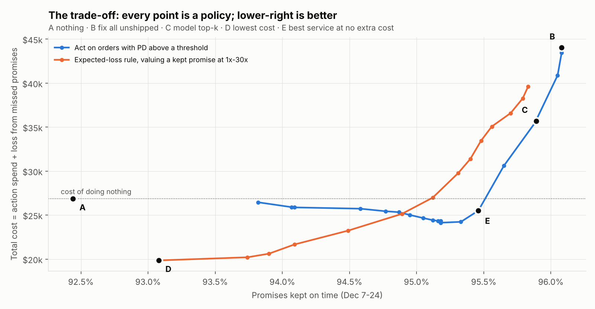
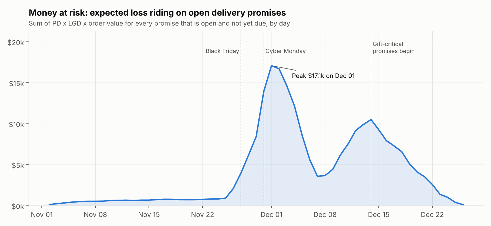
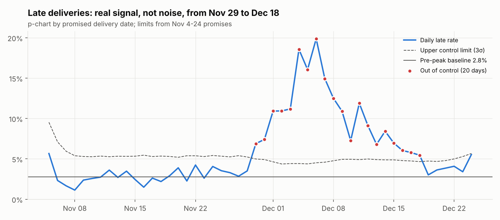
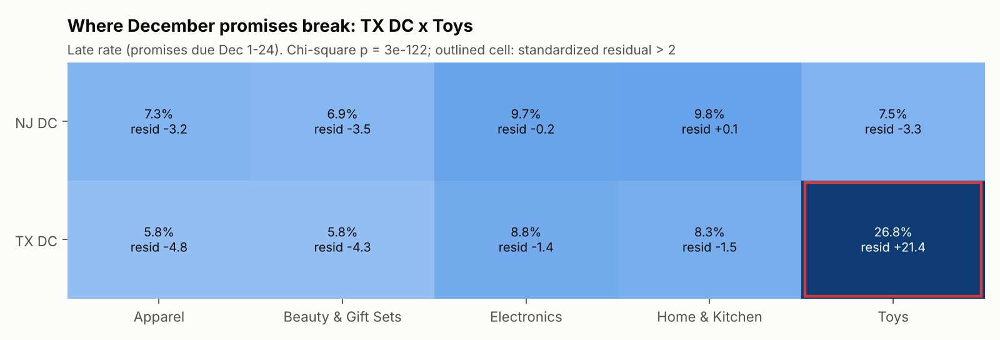
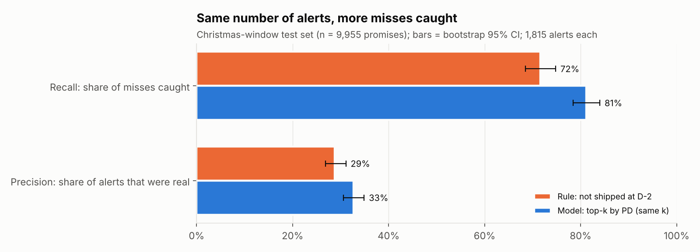
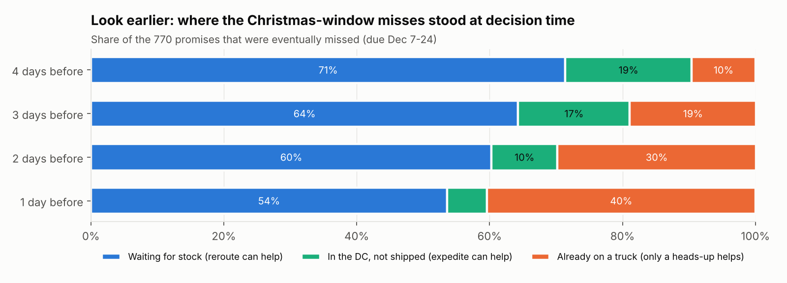
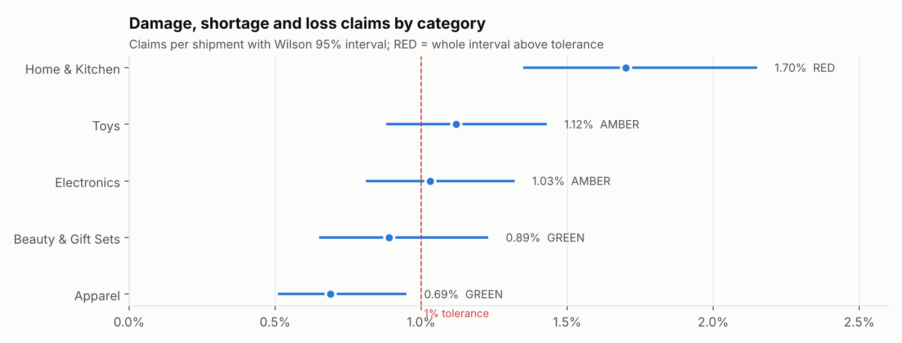

# Holiday Late-Delivery Prediction & Triage: Black Friday to Christmas


*Will it arrive by Christmas?* This project predicts which holiday orders will miss their promised delivery date, and decides whether each one is worth rushing, rerouting, or just a heads-up to the customer.

The twist: every "arrives by Dec 20" on a product page is a promise, and a missed one costs money. So I treated each delivery promise the way a bank treats a loan: **expected loss = probability of default × loss given default × exposure**. Then I used that score to decide, each morning of the 2026 holiday peak, which orders to rescue, how, and which ones aren't worth the money.

**All data is synthetic.** It's one simulated holiday season for a fictional online retailer ("Northpine Goods": 2 distribution centers, 5 product categories, 4 carriers, 25,357 orders, Nov 2–Dec 21, 2026). Data defects and one operational failure were planted on purpose and recorded in an answer key, so I can check that the analysis actually finds them. The cost assumptions are mine and are all in [`src/config.py`](src/config.py).



## Executive summary

| Question | Answer |
|---|---|
| How bad did the peak get? | Late deliveries went from **2.8% before the peak to 14.8% in Cyber Week** (RED against a 5% tolerance). The p-chart puts every promise due Nov 29–Dec 18 outside its control limits, so this is a real shift, not bad luck. |
| Where did it break? | **TX DC × Toys: 10% of December promises but 28% of December misses** (26.8% late vs 7.9% for everything else; chi-square p ≈ 3e-122). The cause: Asia-sourced toys at TX waited an average 1.9 days for stock, versus 0.15 days for the same toys in NJ. |
| Can we see misses coming? | Yes. A logistic regression scored 2 days before each promise was due catches **81% of misses vs 72% for the usual "not shipped yet" rule, with the same number of alerts** (gain +9.6 points, 95% CI +6.8 to +12.4). AUC 0.91 on a held-out Christmas window. |
| What should we do about them? | Blanket-fixing everything that hasn't shipped keeps 96.1% of promises but **costs $17k more than doing nothing**, and 71% of those actions go to orders that would have arrived on time anyway. Acting only where the risk score is ≥ 15% keeps **95.5% of promises for less than doing nothing costs**: it rescues 83% as many promises for a third of the spend. |
| What's the biggest lever? | **Looking earlier.** At D-2, 30% of the eventual misses are already on a truck, where only an apology helps. At D-4 that's 10%. Also, 60% of misses at D-2 are waiting for stock, so the right move is to **ship from the other DC**, not to pay for faster shipping. |

## The idea: a delivery promise is a small loan

| Credit risk | Delivery promise | In this project |
|---|---|---|
| PD: probability of default | Probability the promise is missed | Logistic regression on what's known 2 days before the due date: stage (waiting for stock / in DC / shipped), DC backlog, carrier, lane, tender rejection, days open |
| EAD: exposure at default | Order value | Price × quantity |
| LGD: loss given default | Share of the order value lost if missed | 30% for gift-critical promises (due Dec 14–24), 6% otherwise, plus a $4 "where is my order?" contact and a chance of losing the customer (15% × $150 future margin for a missed Christmas gift) |
| Expected loss | PD × LGD × EAD | Ranks the morning action queue |
| Loan book balance | **Money at risk**: the total expected loss across all open promises | Peaks at $17.1k on Dec 1, 25× its mid-November level |



Each morning, every open order gets the cheapest action that is worth its expected loss:

| Action | When it applies | Cost (assumption) | Effect (assumption) |
|---|---|---|---|
| **Expedite** | The item is in the DC but hasn't shipped | $9–26 by category | Rescues a late order 80% of the time |
| **Reroute** | The item isn't in stock at this DC | Expedite cost + $6 | Ship from the other DC: rescues 70% |
| **Notify** | Anything, including orders already on a truck | $0.50 | Can't rescue it, but cuts the loss from a miss by 30% |

## Findings

**1. The peak wasn't noise.** Using pre-peak promises (Nov 4–24) as the baseline, the daily late rate is above the 3σ upper control limit on every day from Nov 29 to Dec 18. That's 20 straight days, and it returns inside the limits once the December backlog clears.



**2. One cell explains a quarter of December's misses.** The chi-square test of late rate across DC × category is extremely significant, and only one cell has a standardized residual above 2: **TX × Toys (+21.4)**. Drilling into sourcing shows it's Asia-sourced toys only (29% late at TX vs 7.6% at NJ), which points to a late inbound container, not to the DC or the carriers. This is the operational problem I planted, and the test found it without being told where to look.



**3. The model beats the rule at the same workload.** Both methods flag 1,815 orders in the Christmas test window (promises due Dec 7–24, n = 9,955, trained only on promises due before Dec 7). The model catches more of the misses and raises fewer false alarms. Calibration is reasonable: the top-risk decile predicted 48% and saw 54% late, so the model slightly under-predicts at the top. The strongest risk drivers are long planned transit (odds ratio 5.3 per standard deviation), still waiting for stock, and DC backlog (1.4 per standard deviation). Being already shipped is strongly protective.



**4. More action isn't always better.** Five policies, all scored against the true outcomes with the same random draws:

| Policy | Expedite / Reroute / Notify | Action spend | On time | Total cost* | vs rule B |
|---|---|---|---|---|---|
| A. Do nothing | 0 / 0 / 0 | $0 | 92.4% | $26,853 | +$17,176 |
| B. Rule: fix everything not shipped at D-2 | 635 / 1,226 / 0 | $30,433 | **96.1%** | $44,028 | – |
| C. Model top-k (same alert count as B) | 79 / 1,117 / 665 | $21,979 | 95.9% | $35,683 | +$8,345 |
| D. Expected-loss rule: lowest total cost | 25 / 71 / 1,540 | $2,360 | 93.1% | **$19,848** | +$24,181 (CI $22.8k–$25.6k) |
| E. **Best on-time rate at no extra total cost** (PD ≥ 15%) | 64 / 481 / 159 | $9,991 | **95.5%** | $25,508 | +$18,520 (CI $17.3k–$19.8k) |

\*Total cost = action spend + loss from missed promises. The frontier chart at the top shows every threshold, not just these five points.

The decision isn't the model's to make. D is cheapest but lets 705 promises slip. B keeps the most but pays about $82 for each promise it rescues. E is the point I'd take to the ops director: **+3.0 points of on-time delivery and still cheaper than doing nothing.** Going from E to B buys another 0.6 points for $18.5k more.

**5. The clock matters more than the model.** How the Christmas-window misses stood when they were scored:



Moving the decision from D-2 to D-4 cuts the share of misses that are already on a truck from 30% to 10%. Most of the rest are waiting for stock, so they need a reroute or an inventory transfer, not faster shipping.

**6. Claims: Home & Kitchen is the only clear breach.** Physical claims (damaged, short, lost) run 1.70% for Home & Kitchen, which is RED against a 1% tolerance and consistent with bulky items breaking. Toys and Electronics are AMBER. Late-delivery goodwill credits are tracked separately as a service cost.



## The weekly tracker (Excel)

[`outputs/weekly_shipment_tracker.xlsx`](outputs/weekly_shipment_tracker.xlsx) is the file an analyst would send every Monday. Rates, Wilson lower bounds and GREEN / AMBER / RED ratings are **live formulas** (294 of them) driven by tolerance cells on the Settings tab. Change a tolerance and every rating updates.

| Tab | What's on it |
|---|---|
| Settings | Tolerances (inputs), the rating rule, tab guide, abbreviations |
| Weekly tracker | Orders, shipped, late, OTIF, tender rejections, freight, data gaps per week |
| Scorecard | The same KPIs by season period, with best and worst case for unknown deliveries |
| Action queue Dec 18 | The morning list for gift-critical promises due Dec 20, ranked by expected loss |
| Carriers | Tender rejection rate by carrier, peak vs the rest of the season |
| Claims | Claims by category and type, with ratings |
| Policies | The five-policy comparison |
| Data quality | Every cleaning rule that fired, and whether it caught the planted defects |

## Data quality: planted defects and whether I caught them

| Defect (planted on purpose) | Planted | Caught | What the cleaning step does |
|---|---|---|---|
| Duplicate order rows (order system re-sent the message) | 380 | 380 | Keep the first row |
| Duplicate scan events | 507 | 507 | Keep the earliest scan |
| Packed timestamp before picked | 253 | 253 | Swap the two timestamps |
| Delivered timestamp before shipped (bad clock) | 126 | 126 | Treat the delivery time as unknown |
| Missing "shipped" scan | 760 | 760 | Impute as packed time + median gap (94.7% exactly right vs the truth) |
| Missing "delivered" scan | 380 | 380 (+69) | Unknown: excluded from on-time KPIs, bounded best/worst case |
| Quantity shipped > quantity ordered | 76 | 76 | Cap at quantity ordered |
| Negative freight cost | 76 | 76 | Replace with the carrier median |
| Claim pointing to a shipment that doesn't exist | 10 | 10 | Quarantine for manual matching |

The 69 extra "missing delivery scans" are **exactly the 69 parcels that were truly lost in transit.** From the data alone, a lost parcel and a missed scan look identical. That's why unknown deliveries are bounded on the Scorecard instead of quietly dropped: season OTIF is 92.2% on known deliveries, with a range of 90.2% to 92.4% depending on what happened to the unknowns.

## Where math and statistics are used

| Step | Method |
|---|---|
| Is the peak a real shift or noise? | p-chart with 3σ limits from a pre-peak baseline |
| GREEN / AMBER / RED ratings | Wilson 95% interval for a proportion compared with a tolerance (same rule as my [loan control-testing project](https://github.com/sumaiyaa-7/Loan-control-testing)) |
| Is failure concentrated somewhere? | Chi-square test of homogeneity; standardized residuals point to the cell |
| Probability a promise is missed | Logistic regression, time-based train/test split (no leakage from the future), odds ratios for interpretation |
| Is the model really better than the rule? | Bootstrap 95% CIs on precision, recall, the recall gain and AUC |
| Which action, if any? | Expected-value decision: act if PD × rescue probability × loss > cost |
| Is policy E really cheaper than the rule? | Paired bootstrap on per-order total cost (same random draws for every policy) |
| Unknown deliveries | Best-case / worst-case bounds instead of silent exclusion |

## Limitations (please read)

- **Synthetic data, rule-based defects.** Catching every planted defect shows the logic is correct, not that it would perform this well on messy real data. The planted TX toy problem is also stronger than many real ones.
- **The money is assumptions.** LGD, the chance of losing a customer, action costs and rescue rates are educated guesses, and the policy ranking depends on them. That's why they live in one config file, and why the frontier chart shows the whole range rather than one "optimal" answer.
- **Rescue probabilities are fixed numbers.** In reality, whether a reroute works depends on the other DC's stock and capacity on that day, which isn't modeled.
- **The model is scored once per order (D-2).** The money-at-risk curve reuses that one score across the order's life, which is a simplification. A real system would re-score every morning.
- **Under-prediction at the top.** The highest-risk decile is under-predicted by about 6 points. Recalibration (isotonic or Platt) would be the next step before using PD in dollars.
- **No returns yet.** The January returns wave (apparel sizes, opened electronics) is the planned version 2.

## Repo layout

```
src/config.py           every assumption: dates, capacities, carriers, tolerances, costs
src/generate_data.py    synthetic season + planted defects + answer key (seed 2026)
src/validate_clean.py   cleaning rules, data-quality log, check vs answer key
sql/                    KPI queries (SQLite): service, weekly tracker, carriers, claims, hotspot, p-chart
src/run_kpis.py         runs the SQL, adds Wilson ratings, p-chart and chi-square
src/promise_risk.py     PD model, expected loss, action policies, frontier, money-at-risk curve
src/make_charts.py      charts/
src/build_tracker.py    outputs/weekly_shipment_tracker.xlsx
outputs/                every result table as CSV + the Excel tracker
```

## How to reproduce

```bash
pip install -r requirements.txt
python run_all.py        # about a minute; everything is seeded, so results are identical each run
```

Data files are generated into `data/` (git-ignored) rather than committed.

## Skills demonstrated

SQL (CTEs, joins, aggregation), Python (pandas, scikit-learn, SciPy, matplotlib, openpyxl), Excel (live formula-driven tracker with conditional formatting), logistic regression, bootstrap inference, statistical process control, hypothesis testing, expected-value decision analysis, data cleaning with an answer-key check, and writing for an operations audience.
